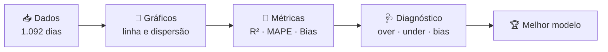

</div>

<br>

## 🏆 Resultado em 10 segundos

> [!TIP]
> **O melhor modelo é o `PRED`.** Suas métricas são muito boas **e** ele não apresenta underfitting, overfitting nem bias. Os outros três modelos têm, cada um, um desses problemas.

| | Modelo | Diagnóstico | R² | MAPE | Bias |
|:-:|:--|:--|--:|--:|--:|
| 🔵 | **`PRED`** 🏆 | ✅ **Saudável** | **0,933** | **4,09%** | **−0,002** |
| 🟠 | `PRED_2` | 🚩 Overfitting | 1,000 | 0,09% | 0,000 |
| 🟢 | `PRED_3` | 🚩 Underfitting | 0,111 | 15,68% | −0,048 |
| 🟣 | `PRED_4` | 🚩 Bias | −3,141 | 39,55% | −3,002 |

> 💡 **Repare:** o `PRED_2` tem números "melhores" que o `PRED` — e é exatamente isso que desperta desconfiança. **Modelo perfeito não existe**, então um R² de 1,000 é sinal de alerta, não de vitória.

<details>
<summary><b>➕ Ver mais métricas (MAE e RMSE)</b></summary>

<br>

| Modelo | MAE | RMSE |
|:--|--:|--:|
| `PRED` | 0,304 | 0,386 |
| `PRED_2` | 0,007 | 0,008 |
| `PRED_3` | 1,181 | 1,403 |
| `PRED_4` | 3,002 | 3,027 |

</details>

<br>

## 📦 Os dados

| | |
|:--|:--|
| **Arquivo** | `train_predictions.xlsx` |
| **Período** | 1.094 dias, de 03/07/2023 a 30/06/2026 |
| **Colunas** | `TRUE` (valor observado) + `PRED`, `PRED_2`, `PRED_3`, `PRED_4` (previsão de cada modelo) |
| **Limpeza** | 2 dias sem dados (13 e 14/10/2025) removidos → **1.092 observações válidas** |



<br>

## 🧠 Conceitos rápidos

**As três métricas que usei**

| Métrica | Pergunta que responde | Bom quando… |
|:--|:--|:--|
| **R²** | Quanto da variação dos dados o modelo explica? | está perto de **1** *(negativo = pior que chutar a média)* |
| **MAPE** | Em média, quantos % o modelo erra? | é **baixo** |
| **Bias** | O modelo erra sempre para o mesmo lado? `média(previsto − observado)` | está perto de **0** |

**Os três problemas que aprendi a reconhecer**

| Problema | O que acontece | Como aparece |
|:--|:--|:--|
| 🚩 **Overfitting** *(superajuste)* | O modelo **decorou** os dados em vez de aprender o padrão | Métricas perfeitas demais: R² ≈ 1, erro ≈ 0 |
| 🚩 **Underfitting** *(subajuste)* | O modelo **não aprendeu** o padrão | R² baixo, MAPE alto, pontos espalhados longe da linha ideal |
| 🚩 **Bias** *(viés)* | O modelo **erra sempre para o mesmo lado** | Bias longe de zero; nuvem de pontos paralela à linha ideal, mas deslocada |

<br>

## 📈 Vendo a diferença

Cada modelo tem a mesma cor em todos os gráficos e na tabela acima (🔵 🟠 🟢 🟣).

<p align="center">
  
</p>

<p align="center">
  
</p>

<details>
<summary><b>📅 Ver as séries temporais (zoom de 60 dias)</b></summary>

<br>

<p align="center">
  
</p>

</details>

<br>

## 🔬 Modelo por modelo

### 🔵 `PRED` &nbsp;—&nbsp; ✅ Saudável · melhor modelo

| R² | MAPE | Bias |
|:-:|:-:|:-:|
| **0,933** | **4,09%** | **−0,002** |

- Os pontos ficam em volta da linha ideal, sem forma estranha e sem desvio para nenhum lado.
- O erro médio é ≈ 0: ele subestima em 51% dos dias e superestima em 49% — erra para os dois lados, **por acaso e não por padrão**.
- Em 82% dos dias o erro é menor que 0,5; o maior erro é 1,38.
- Ainda erra um pouco (4,09%) — e está tudo bem: **modelo perfeito não existe**.

### 🟠 `PRED_2` &nbsp;—&nbsp; 🚩 Overfitting

| R² | MAPE | Bias |
|:-:|:-:|:-:|
| 1,000 | 0,09% | 0,000 |

- A previsão é praticamente idêntica ao valor real: o erro **nunca passa de 0,01** em 1.092 dias.
- Dados reais têm ruído. Acertar tudo assim indica que o modelo **decorou** os dados em vez de aprender o padrão.
- É o caso clássico do "bom demais para ser verdade".

### 🟢 `PRED_3` &nbsp;—&nbsp; 🚩 Underfitting

| R² | MAPE | Bias |
|:-:|:-:|:-:|
| 0,111 | 15,68% | −0,048 |

- Explica só ~11% da variação dos dados (R² = 0,111).
- O bias é ≈ 0 porque ele erra para cima e para baixo — mas **erra muito**: entre −2,0 e +2,0, e só 21% dos dias ficam com erro menor que 0,5.
- Não captou o padrão dos dados.

### 🟣 `PRED_4` &nbsp;—&nbsp; 🚩 Bias

| R² | MAPE | Bias |
|:-:|:-:|:-:|
| −3,141 | 39,55% | −3,002 |

- **Subestima em 100% dos dias**, em média por 3,0 unidades.
- Acerta o "formato" da curva (correlação de 0,966, igual à do `PRED`), mas ela está toda deslocada para baixo.
- R² negativo: ele vai pior do que simplesmente prever a média todos os dias.

<br>

## 🎓 O que aprendi

1. **O melhor modelo é o `PRED`**, porque suas métricas são muito boas **e** ele não apresenta underfitting, overfitting nem bias.
2. **Modelo perfeito não existe.** Um R² de 1,000 (`PRED_2`) não é vitória — é sinal de overfitting.
3. **Cada problema tem uma assinatura:** overfitting = métricas perfeitas demais · underfitting = erros grandes para os dois lados · bias = erro sempre para o mesmo lado.
4. **Olhar gráficos e métricas juntos.** Uma métrica sozinha engana: o `PRED_4` tem a mesma correlação do `PRED`, mas um R² de −3,141.

<br>

## 🔭 Próximos passos

> [!NOTE]
> As previsões deste projeto estão em `train_predictions.xlsx`, ou seja, são **previsões de treino**.

- [ ] Repetir a avaliação em **dados de teste/validação** — é lá que o overfitting do `PRED_2` se confirma (o desempenho deve cair) e que o `PRED` prova que generaliza.
- [ ] Incluir MAE e RMSE no notebook, ao lado de R², MAPE e Bias.

<br>

## 🚀 Como rodar

```text
projeto/
├── avaliar_modelo.ipynb     # análise completa: gráficos + métricas
├── train_predictions.xlsx   # previsões dos 4 modelos + valor observado
├── assets/                  # imagens deste README
└── README.md
```

```bash
pip install pandas numpy matplotlib seaborn scikit-learn openpyxl jupyter
jupyter notebook avaliar_modelo.ipynb
```

<details>
<summary><b>🧪 Calcular as métricas dos 4 modelos de uma vez</b></summary>

<br>

```python
import pandas as pd
from sklearn.metrics import r2_score, mean_absolute_percentage_error

df = pd.read_excel("train_predictions.xlsx", index_col=0).dropna()

for modelo in ["PRED", "PRED_2", "PRED_3", "PRED_4"]:
    r2   = r2_score(df["TRUE"], df[modelo])
    mape = mean_absolute_percentage_error(df["TRUE"], df[modelo]) * 100
    bias = (df[modelo] - df["TRUE"]).mean()
    print(f"{modelo:<7} R²: {r2:7.3f} | MAPE: {mape:6.2f}% | Bias: {bias:7.3f}")
```

</details>

<br>

<div align="center">

<sub>Projeto de aprendizado em avaliação de modelos de inteligência artificial.</sub>

</div>
